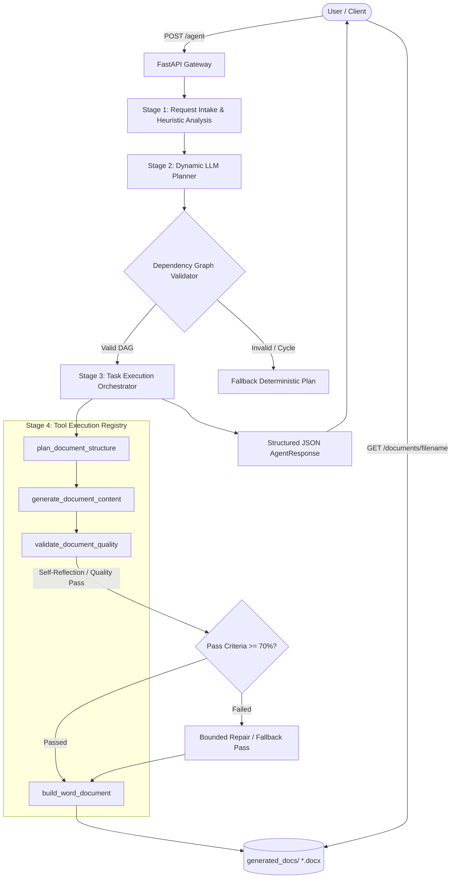

# Autonomous Document Agent — Architecture Specification

## Overview

The **Autonomous Document Agent** is a production-minded Python application engineered to transform natural-language requests into structured, executive-grade Microsoft Word (`.docx`) documents.



---

## 1. Core Architectural Components

### 1.1 Request Intake & Boundary Validation (`app/schemas.py`, `app/main.py`)
- Validates request length (rejects blank, whitespace, or requests $< 5$ characters with HTTP 422).
- Enforces strict regex validation on document downloads to prevent directory traversal (`..`, `/`, `\`).
- Identifies missing facts and forms explicit assumptions without inventing real-world commitments.

### 1.2 Dynamic LLM Planner (`app/agent/planner.py`)
- Analyzes natural-language requests and queries the Groq API (or utilizes heuristic intent mapping).
- Synthesizes a discrete task list (3–5 tasks) with explicit dependencies (`dependencies: ["task_1"]`).
- Validates the dependency graph using **Kahn's Topological Sort Algorithm** to detect undefined task IDs, self-references, and cycles.

### 1.3 Tool Registry (`app/tools/registry.py`)
- Implements an explicit, isolated registry of tools:
  - `plan_document_structure`: Generates section blueprints, hierarchy, and table requirements.
  - `generate_document_content`: Generates section narratives, milestone tables, risk matrix, and recommendations.
  - `validate_document_quality`: Runs a 5-point reflection check on document integrity and completeness.
  - `build_word_document`: Uses `python-docx` with XML styling, palette colors, and custom margins to render `.docx` files.

### 1.4 Execution Orchestrator (`app/agent/executor.py`)
- Executes tasks sequentially adhering to topological order.
- Updates task state from `pending` -> `in_progress` -> `completed` / `failed`.
- Attaches execution results and error logs to the execution trace.
- Triggers bounded correction if reflection fails.

---

## 2. Failure Handling & Resilience

| Failure Mode | Impact | Mitigation Strategy |
| :--- | :--- | :--- |
| **Missing API Key** | LLM inference unavailable | System automatically identifies `llm_mode: deterministic_fallback` without fabricating LLM results. |
| **Groq API Timeout / Rate Limit** | Provider failure | Caught via `httpx.TimeoutException`, logging details and gracefully falling back to deterministic synthesis. |
| **Malformed LLM JSON** | JSONDecodeError | Multi-strategy JSON extractor checks raw text, markdown blocks (````json`), and outer brace boundaries before falling back. |
| **Circular Task Dependencies** | Infinite execution loop | Pre-execution DAG validation with cycle detection aborts invalid plans immediately. |
| **Quality Check Failure** | Incomplete document content | Reflection engine detects gaps (e.g., missing tables, short summary) and triggers a single bounded correction attempt. |
| **Path Traversal Attacks** | Arbitrary file access | Download route validates filenames with `^[a-zA-Z0-9_\-\.]+\.docx$` and rejects paths containing `..` or slashes. |

---

## 3. Engineering Tradeoffs

### Autonomous Multi-Step Planning vs. Hardcoded Pipelines
- **Tradeoff**: Autonomous planning requires dependency validation and schema parsing overhead, whereas a hardcoded linear script is simpler.
- **Decision**: Multi-step planning was selected because it provides complete observability of the agent's internal reasoning, enables modular tool invocation, and allows dynamic re-ordering of tasks based on document type.

### Single-Agent Orchestration vs. Multi-Agent Frameworks
- **Tradeoff**: Frameworks like CrewAI or LangGraph add complex agent-to-agent message passing and heavier dependencies.
- **Decision**: A lightweight single-agent orchestrator with explicit tools was selected to avoid framework bloat, guarantee sub-second deterministic execution, and ensure complete predictability for technical evaluation.
