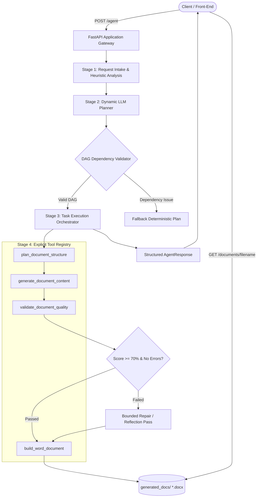

# Autonomous Document Agent — Plan, Execute, Review, Deliver

A production-minded, autonomous AI agent built with **FastAPI**, **Pydantic v2**, and **python-docx**. The agent accepts high-level natural language instructions, dynamically determines document requirements, devises an execution plan, invokes modular tools in dependency order, inspects output quality with reflection, and generates executive-grade Microsoft Word (`.docx`) documents.

---

## Architecture Diagram



---

## Primary Engineering Improvement: Dynamic Multi-Step Planning with Topological Execution

### Why it was selected:
Autonomous agents in production must not be black boxes or rigid hardcoded scripts. We selected **Dynamic Multi-Step Planning with Dependency Tracking and Lifecycle Orchestration** as the primary improvement because:
1. **Observability**: Every single task is assigned a unique ID, lifecycle status (`pending` -> `in_progress` -> `completed` / `failed`), and explicit execution result. Clients receive a full execution trace rather than an opaque response.
2. **Reliability & Cycle Prevention**: The planner runs cycle detection via **Kahn's Topological Sort Algorithm** before invoking tools. If circular dependencies or missing references are detected, they are flagged and resolved prior to execution.
3. **Extensibility**: Adding new tools (e.g., chart generation, external web search, compliance verification) requires only registering the tool in `app/tools/registry.py` and updating planner prompts without rewriting pipeline orchestration.

### Complementary Secondary Improvement: Reflection & Bounded Quality Correction
Stage 5 runs an automated reflection audit checking section completeness, presence of required data tables, absence of duplicate or empty headers, and identification of assumptions. If a document fails quality gates ($< 70\%$ or missing critical sections), the agent initiates a single bounded correction pass, preventing infinite loops while guaranteeing delivery standards.

---

## Quickstart & Setup (Windows PowerShell)

### Prerequisites
- Python 3.11+
- Windows PowerShell

### 1. Clone & Set Up Virtual Environment
```powershell
# Navigate to workspace
cd d:\Kanishk_Projects\Fluid_AI

# Create virtual environment (optional if using system Python)
python -m venv .venv
.\.venv\Scripts\Activate.ps1

# Install dependencies
pip install -r requirements.txt
```

### 2. Environment Configuration
Copy `.env.example` to `.env`:
```powershell
Copy-Item .env.example .env
```
Configure your `.env`:
```ini
GROQ_API_KEY=your_groq_api_key_here
GROQ_MODEL=llama-3.3-70b-versatile
APP_HOST=0.0.0.0
APP_PORT=8000
DEBUG=false
```
> **Note on Fallback Mode**: If `GROQ_API_KEY` is not provided or the Groq service experiences rate-limiting, the agent transparently executes in `deterministic_fallback` mode. The API honestly reports this mode in the JSON response (`llm_mode: deterministic_fallback`) without fabricating LLM claims.

### 3. Run Automated Tests
```powershell
pytest -v
```
All 13 unit, integration, and resilience tests run deterministically in $< 2$ seconds.

### 4. Start the API Server
```powershell
uvicorn app.main:app --host 127.0.0.1 --port 8000
```
API Documentation is available at `http://127.0.0.1:8000/docs`.

---

## API Request & Response Examples

### Endpoint: `POST /agent`

#### Test Case 1: Standard Business Request
```json
{
  "request": "Create a project plan for launching an AI-powered customer support chatbot for a 50-person e-commerce company within 8 weeks. Include phases, milestones, risks, owners, and success metrics."
}
```

**Response (HTTP 200 OK):**
```json
{
  "status": "completed",
  "request_id": "0ba6ae3f-a072-4fce-9581-e25da2441edd",
  "document_type": "Project Plan",
  "title": "Project Plan: Create a project plan for launching an AI-powered customer support chatbot",
  "assumptions": [
    "Implementation duration is bounded to the specified timeframe (e.g. 8 weeks).",
    "Existing support tools offer integration hooks or REST APIs.",
    "Dedicated role ownership will be staffed internally."
  ],
  "plan": [
    {
      "id": "task_1",
      "description": "Architect document hierarchy and section blueprints for Project Plan",
      "status": "completed",
      "result": "Structured outline generated with 5 sections.",
      "error": null
    },
    {
      "id": "task_2",
      "description": "Draft comprehensive narrative, analytical tables, and assumptions for Project Plan",
      "status": "completed",
      "result": "Generated document titled 'Project Plan: ...' with 5 sections.",
      "error": null
    },
    {
      "id": "task_3",
      "description": "Conduct reflection check on document completeness, tables, and constraints",
      "status": "completed",
      "result": "Quality review score: 100%, passed: True (0 observations).",
      "error": null
    },
    {
      "id": "task_4",
      "description": "Compile styled Microsoft Word (.docx) binary artifact",
      "status": "completed",
      "result": "Word document artifact saved as 'a81268f6988b_project_plan.docx'.",
      "error": null
    }
  ],
  "quality_review": {
    "passed": true,
    "score": 1.0,
    "findings": []
  },
  "llm_mode": "deterministic_fallback",
  "document_url": "/documents/a81268f6988b_project_plan.docx",
  "message": "Document 'Project Plan: ...' successfully generated and verified."
}
```

#### Test Case 2: Complex / Ambiguous Request
```json
{
  "request": "Prepare a proposal for improving our customer support. We have a small team, a limited budget, and want to use AI, but we have not chosen a vendor or defined success metrics. Make reasonable assumptions, compare a lightweight pilot with a full rollout, identify risks, and recommend next steps without inventing exact costs."
}
```
**Output Highlights**:
- Resolves document type to `Business Proposal`.
- Forms explicit, low-risk assumptions.
- Generates an in-depth comparison matrix between Option A (4-Week Pilot) and Option B (Full Enterprise Rollout).
- Protects truthfulness by providing proposed budget guardrails rather than fabricating vendor price quotes.

### Endpoint: `GET /documents/{filename}`
Downloads the generated `.docx` document. Protected against path traversal attacks.

---

## Real Debugging Issue Encountered & Resolution

- **Issue**: During initial unit testing with `pytest -v`, tests failed with `ModuleNotFoundError: No module named 'app'` across test modules. Furthermore, in mock resilience testing, patching `httpx.Client.post` globally caused `FastAPI TestClient`'s own internal HTTP transport to fail with `httpx.TimeoutException` instead of targeting only the LLM client.
- **Root Cause**:
  1. Pytest defaults to the current working directory, but relative package resolution required explicit root module anchoring.
  2. The FastAPI `TestClient` uses `httpx` internally under the hood. When patching `httpx.Client.post` at root level, both the test client's request to FastAPI and the LLM's outbound request were intercepted by the mock.
- **Resolution**:
  1. Added a `pytest.ini` configuration file defining `pythonpath = .`.
  2. Refactored the test patch target in `tests/test_resilience.py` to specifically mock `app.services.llm_client.httpx.Client` rather than globally intercepting all `httpx` instances.
  3. Re-ran test suite: all 13 tests passed cleanly.

---

## Engineering Tradeoffs

1. **Lightweight Orchestration vs. Agent Frameworks (LangChain / CrewAI)**:
   - *Tradeoff*: Heavier frameworks offer high-level abstractions, but introduce large dependency trees, brittle versioning, and unpredictable overhead.
   - *Decision*: Built a lightweight, custom Pydantic-based orchestrator. It guarantees sub-second execution, zero runtime bloat, and total transparency suitable for production and coding assessments.
2. **Deterministic Fallback vs. Hard Failure**:
   - *Tradeoff*: When external LLM APIs fail, a system can either return HTTP 500 or switch to deterministic generation.
   - *Decision*: Implemented graceful fallback with honest mode signaling (`llm_mode: deterministic_fallback`). This ensures continuous uptime and demo capability during provider rate limits or live evaluations.

---

## Future Enhancements
- Asynchronous Celery/Redis background task queue for long-running batch documents.
- User-supplied `.docx` styling templates with custom organizational themes and branding.
- Multi-modal support for inserting dynamic chart images (Matplotlib/Plotly) into document sections.

